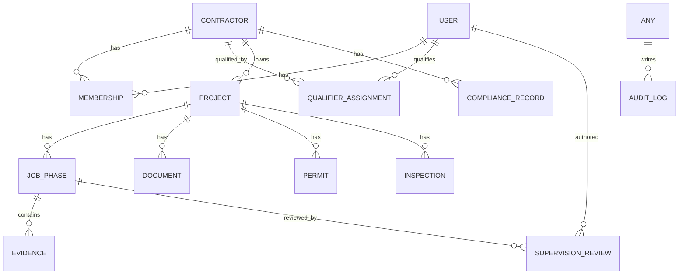
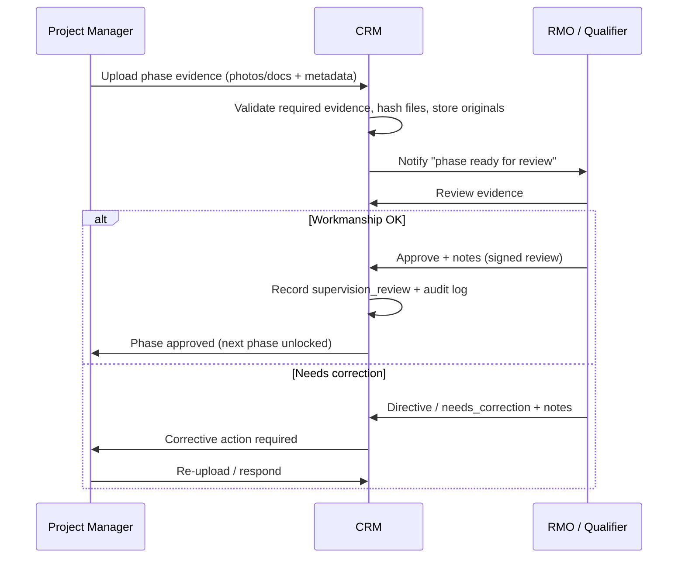

# RMO Supervision CRM — Build & Compliance Plan

Working plan for a supervision-management CRM that lets a **Responsible Managing Officer (RMO)** oversee roofing jobs across **three separate C-39 licensed contractors** and produce defensible evidence of **CSLB-required supervision and control**.

> **Not legal advice.** This document summarizes California statutes to guide the build. Confirm all licensing/supervision conclusions with the CSLB and a construction-law attorney *before* relying on the "one RMO / three contractors" structure. See [Critical Compliance Flag](#0-critical-compliance-flag-read-first) below — it may change the whole premise.

---

## 0. Critical Compliance Flag (read first)

The scenario is "one person is the RMO/qualifier for **three** C-39 contractors." California law limits this.

**BPC §7068.1** — a qualifying individual **may not** qualify an *additional* firm **unless one of these connections exists** between the firms:

1. **Common ownership of at least 20%** of the equity of *each* firm, **or**
2. The additional firm is a **subsidiary or joint venture** of the first (≥20% equity owned), **or**
3. The **majority of partners/officers/managers are the same**.

**And even then**, a qualifier may act for **no more than three firms in any one-year period** (hard cap).

### What this means for the build

| Situation | Lawful for one RMO? |
| --- | --- |
| 3 contractors with ≥20% common ownership / shared majority officers | Likely yes, up to the 3-firm cap |
| 3 **independently owned** contractors, no ownership/officer overlap | **Likely NO** — one qualifier cannot lawfully qualify all three |

If the three contractors are independent businesses with no ownership/officer link, then a **single RMO qualifying all three is likely not permitted**. Options to resolve before/while building:

- Confirm/establish the ≥20% common-ownership or shared-officer relationship, **or**
- Use a **separate qualifier per company** (each an RME/RMO), and let this app be a **multi-qualifier supervision platform** rather than a single-RMO tool, **or**
- Restructure the engagement (e.g., consulting vs. qualifying) with counsel.

### Selected structure (decided 2026-09-17)

**The RMO will hold ≥20% equity in each of the three separate entities.** This satisfies **§7068.1(a)(1)** — the RMO's own ≥20% stake in each firm *is* the required "common ownership" thread. The three companies may remain **separate, independent entities**; they do **not** need to be commingled, affiliated, subsidiaries, or share officers. Three firms = exactly at the one-year cap.

Conditions that must stay true (encode as onboarding checklist + stored evidence):

- **Bona fide, documented ≥20% equity** in each entity (cap table / stock certificates / operating agreement) — not nominal; CSLB may request proof.
- RMO is an **actual appointed officer** of each corporation (Statement of Officers), which is what makes the RMO (vs. RME) path valid.
- **Eligibility ≠ supervision.** The 20% + officer status makes the RMO *eligible* to qualify all three; the RMO must still exercise real "direct supervision or control" — the purpose of this app.
- Each entity keeps its **own C-39 license, own workers' comp, own insurance.**
- **Hard cap of 3** firms/year — no fourth entity may be added.

**Design decision:** Build the data model to support **N qualifiers ↔ N contractors** from day one, and record the **qualifying relationship + ownership basis** (here: `common_ownership_20`, with `ownership_pct` per entity) for each contractor. This documents the §7068.1 basis as compliance evidence and keeps the app flexible if the structure ever changes.

Additional statutory limits to encode:

- **BPC §7068(e):** a person qualifying a firm **cannot hold another active license** while acting as qualifier, except within the §7068.1 framework.
- **BPC §7068(c):** "bona fide employee" + **"actively engaged" = working 32 hrs/week or 80% of the hours the business operates, whichever is less.** (Primarily an RME test, but relevant to proving the qualifier is not a "phantom.")
- **Penalties (§7068.1(e)):** violation is a **misdemeanor**, fine **$3,000–$5,000**, and grounds for **license discipline**. CSLB actively pursues "phantom qualifier" cases — the entire purpose of this app is to prove supervision is real.

---

## 1. Purpose & Scope

**Primary goal:** Give each contractor's **Project Managers (PMs)** a simple, mobile-first way to upload job documentation, and give the **RMO/qualifier** the tools to review, direct, sign off, and **generate an audit-ready supervision record** for every job — satisfying "direct supervision or control" under **BPC §7068.1**.

**In scope (MVP):**
- Multi-contractor (multi-tenant) job tracking with strict data isolation.
- PM upload of contracts, permits, and phase photos (tearoff / decking / install / final).
- Photo/document integrity: timestamp, GPS/EXIF capture, immutable storage.
- RMO review + phase sign-off workflow (the core compliance artifact).
- Exportable per-job "Supervision File" (PDF/ZIP) for CSLB/audit/legal.
- Immutable audit log.

**Out of scope (initially):** estimating/bidding, invoicing/payments, payroll, full accounting, lead-gen (that lives in [PLAN.md](PLAN.md)). Integrations can come later.

---

## 2. Legal & Regulatory Compliance Requirements

These drive features — every requirement below should map to something the app captures or enforces.

### 2.1 CSLB supervision ("direct supervision or control") — the core
Per **BPC §7068.1(c)**, "direct supervision or control" means any of:
- **(A)** Supervising construction operations
- **(B)** Managing construction activities by making **technical and administrative decisions**
- **(C)** **Checking jobs for proper workmanship**
- **(D)** Supervision on construction sites

"Supervision and control" also includes **monitoring and being available to assist others to whom supervision has been delegated.**

**App implication:** Every job must accumulate date-stamped evidence that the qualifier did ≥1 of A–D. The **RMO sign-off record** (who, when, what was reviewed, decision/notes) is the primary evidence. Support **delegation** (RMO delegates to a field supervisor) while keeping the RMO's monitoring trail.

### 2.2 Qualifier eligibility & relationship (BPC §7068, §7068.1)
- Store, per contractor: license #, classification (**C-39**), qualifier identity, qualifier type (**RMO/RME**), and the **§7068.1 basis** (ownership %, subsidiary/JV, or shared officers).
- Enforce the **3-firm cap** and **one-active-license** rule as validation warnings.
- Track qualifier "actively engaged" evidence (supervision activity log ≈ engagement proof).

### 2.3 Records retention
- CSLB and civil exposure make **long retention essential**. Plan for **minimum ~5 years** after job completion for the full supervision file (align to statute of limitations for construction defect — latent defects can reach **10 years** under CCP §337.15). **Design retention as configurable; default 10 years for job evidence.**
- **Legal hold**: ability to freeze/exempt records tied to a claim or CSLB inquiry from deletion.

### 2.4 Home improvement / contract compliance (context, not enforced by app initially)
- Residential roofing contracts are **Home Improvement Contracts** under **BPC §7159** (required notices, 3-day right to cancel, down-payment limits: lesser of $1,000 or 10%). The app should **store the signed contract** and flag missing key fields, but full contract-authoring is out of MVP scope.

### 2.5 Permit & inspection compliance
- Roofing requires a **building permit** from the local AHJ; many jurisdictions require a **sheathing/nailing inspection before cover** and a **final inspection**. Capture permit # and inspection sign-offs as job evidence.

### 2.6 Data privacy (homeowner PII)
- Contracts contain homeowner **PII** (name, address, phone, possibly financing). California **CCPA/CPRA** applies. Requirements: least-privilege access, encryption in transit + at rest, signed/expiring URLs for documents, deletion/erasure workflow (subject to legal-hold and retention), and a documented data-processing/roles map.
- **Cross-tenant isolation is a privacy control**, not just a UX nicety — Contractor A must never see Contractor B's homeowners or jobs.

### 2.7 Worker classification / insurance (store-and-verify)
- Roofing (C-39) has **mandatory workers' comp** even with no employees (BPC §7125). Store each contractor's **WC policy + expiration** and **general liability**, and surface expiration alerts. Verification only; not enforcement.

### 2.8 Evidence integrity (for discipline/litigation)
- Photos/docs may become evidence in CSLB discipline or civil suits. Preserve **original files + metadata** (no destructive re-encoding), record **upload chain of custody**, and make the **audit log append-only**.

---

## 3. Actors & Roles (RBAC)

| Role | Scope | Key permissions |
| --- | --- | --- |
| **RMO / Qualifier (Supervisor)** | Cross-tenant (only the contractors they qualify) | Read all jobs for their contractors; review & **sign off** phases; add technical/admin directives; export supervision files; place legal holds |
| **Contractor Admin / Owner** | Single contractor | Manage that contractor's users, projects, insurance/license docs; read all their jobs |
| **Project Manager (PM)** | Single contractor | Create jobs; upload contracts/permits/photos; respond to RMO directives |
| **Field Crew (optional, v2)** | Single contractor, assigned jobs | Photo upload only (mobile) |
| **Auditor (read-only, v2)** | Scoped/temporary | Read + export a defined set (e.g., for a CSLB request) |

Principles: **least privilege**, per-contractor isolation, RMO sees **only** the contractors they qualify, all privileged actions audited.

---

## 4. Core Domain Model

Key tables (columns are indicative):

- **contractor** — id, legal_name, dba, cslb_license_no, classification (C-39), license_status, license_expiry, address.
- **user** — id, name, email, phone, auth_id, is_active.
- **membership** — user_id, contractor_id, role, status. (User ↔ contractor + role.)
- **qualifier_assignment** — user_id (qualifier), contractor_id, qualifier_type (RMO/RME), **section_7068_1_basis** (enum: common_ownership_20 / subsidiary_jv / shared_majority_officers / single_firm), ownership_pct, effective_from, effective_to. *(Encodes §7068.1; powers the 3-firm-cap and one-license validations.)*
- **project (job)** — id, contractor_id, job_number, homeowner_name, site_address (PII-flagged), roof_type (comp/tile/flat/TPO/SPF/metal), scope_summary, contract_value, status, created_by, created_at.
- **job_phase** — id, project_id, phase (enum: `contract`, `permit`, `material_delivery`, `tearoff`, `decking`, `underlayment`, `city_inspection_presheathing`, `install`, `final_inspection`, `completion`), status (`pending`/`submitted`/`under_review`/`approved`/`rejected`), required_evidence[], completed_at.
- **evidence** — id, job_phase_id, type (photo/video/doc), storage_key, original_filename, mime, sha256_hash, captured_at, gps_lat, gps_lng, exif_json, uploaded_by, uploaded_at. *(Hash + original metadata = integrity/chain of custody.)*
- **document** — id, project_id, doc_type (contract/permit/COI/warranty), storage_key, sha256_hash, uploaded_by, uploaded_at.
- **permit** — id, project_id, permit_no, jurisdiction, issued_date, doc_id.
- **inspection** — id, project_id, type (sheathing/nailing/final), result, inspector_ref, date, doc_id.
- **supervision_review** — id, job_phase_id, reviewer_user_id (qualifier), decision (`approved`/`needs_correction`/`directive`), review_notes, technical_directives, reviewed_at, delegated_to (nullable). **← primary CSLB compliance artifact.**
- **compliance_record** — id, contractor_id, type (workers_comp/gl_insurance/license_renewal), reference_no, effective, expires, doc_id. *(Drives expiration alerts.)*
- **audit_log** — id, actor_user_id, contractor_id, entity, entity_id, action, before/after (jsonb), ip, user_agent, created_at. **Append-only.**

---

## 5. Roofing Job Lifecycle & Required Evidence

Ordered phases with the evidence the PM must supply and what the RMO reviews. This is the backbone of the app's workflow engine.

| # | Phase | PM uploads / provides | RMO supervision focus (§7068.1) |
| --- | --- | --- | --- |
| 1 | **Contract** | Signed home-improvement contract (photo/PDF) | Scope correct; §7159 basics present; admin decision |
| 2 | **Permit** | Building permit #, permit doc | Permit pulled before work; correct jurisdiction |
| 3 | **Material delivery** | Photos of delivered materials | Correct material/spec vs. contract |
| 4 | **Tearoff** | Photos of removed roof / exposed deck | Scope verification; hidden-condition decisions |
| 5 | **Decking / sheathing** | Photos of deck condition, dry-rot repairs, **code nailing** | **Checking workmanship (C)**; technical decisions (B) |
| 6 | **Underlayment** | Photos of felt / ice-&-water / flashing | Proper install; workmanship check |
| 7 | **Pre-cover inspection** (if AHJ requires) | Inspection sign-off doc | Confirm passed before cover |
| 8 | **Install** | Photos of finished field, penetrations, edges, ridge | **Checking workmanship (C)**; supervising ops (A) |
| 9 | **Final inspection** | City final sign-off | Confirm passed |
| 10 | **Completion** | Final photos, warranty, notice of completion | Sign-off; close supervision file |

**Rules to encode:**
- Each phase defines **required_evidence** (min photo counts / doc types). A phase can't be marked `submitted` until requirements are met.
- Phase advances to `approved` **only** on an RMO `supervision_review`. That review is the compliance proof.
- **Gating option (configurable):** certain phases (e.g., cover/install) cannot start until the prior phase is RMO-approved — mirrors real supervision and strengthens the compliance narrative.

---

## 6. Supervision Workflow (the compliance engine)

Compliance properties this produces:
- A **timestamped, attributable chain** of qualifier reviews per job = evidence of A/B/C/D under §7068.1.
- **Delegation support:** RMO can delegate on-site checks to a field supervisor while retaining a **monitoring** record ("supervision and control" includes monitoring delegated work).
- **Supervision activity log** per qualifier ≈ evidence they are **actively engaged**, countering "phantom qualifier" allegations.

---

## 7. Functional Requirements

### MVP
- [ ] Auth + RBAC (RMO / Contractor Admin / PM), per-contractor isolation.
- [ ] Contractor onboarding: license, classification, qualifier assignment + §7068.1 basis.
- [ ] Project (job) CRUD, per contractor.
- [ ] Phase workflow with required-evidence enforcement.
- [ ] Mobile-first photo/document upload with EXIF/GPS + timestamp capture and file hashing.
- [ ] RMO review + sign-off (`supervision_review`), with notes/directives.
- [ ] Notifications (email/SMS/push) on "ready for review" and "correction required."
- [ ] **Per-job Supervision File export** (PDF summary + evidence ZIP with metadata manifest).
- [ ] Append-only audit log.

### v1
- [ ] Cross-contractor RMO dashboard: jobs awaiting review, aging, per-contractor KPIs.
- [ ] Insurance/license expiration alerts (`compliance_record`).
- [ ] Phase gating (block cover until prior phase approved).
- [ ] Saved report templates; scheduled monthly supervision summary per contractor.
- [ ] Legal-hold flag + retention policy engine.

### v2+
- [ ] Field-crew role + offline-capable PWA upload queue.
- [ ] Photo annotation / markup by RMO.
- [ ] AI assist: flag likely workmanship issues, auto-check required photos present, OCR permit/contract fields.
- [ ] Read-only **Auditor** share links (scoped, expiring) for CSLB requests.
- [ ] E-signature on completion sign-offs.

---

## 8. Non-Functional Requirements

- **Security:** encryption in transit (TLS) + at rest; signed, short-lived URLs for evidence; least-privilege RBAC enforced at the data layer (row-level security), not just UI.
- **Data isolation:** every row scoped by `contractor_id`; RMO access limited to their `qualifier_assignment` set.
- **Integrity:** store original files unmodified; SHA-256 per file; append-only audit log.
- **Retention:** configurable; **default 10 years** for job evidence; legal-hold override.
- **Availability/backup:** automated DB + storage backups; documented restore.
- **Mobile:** field-first responsive/PWA; camera capture; tolerant of poor signal (retryable uploads).
- **Performance:** large photo uploads (multi-MB) must be chunked/resumable; thumbnails generated server-side.
- **Auditability:** every privileged action logged with actor, time, IP.
- **Privacy:** PII fields tagged; erasure workflow honoring retention/hold.

---

## 9. Proposed Technical Architecture

Fits the existing Netlify-centric workflow (static sites + `netlify/functions/`), while adding a real datastore, auth, and secure file storage.

**Recommended stack (fastest path to a compliant MVP):**

| Layer | Choice | Why |
| --- | --- | --- |
| Frontend | **React (Next.js) or SvelteKit**, mobile-first PWA | Camera upload, offline queue, installable on phones |
| Auth | **Supabase Auth** (or Clerk/Auth0) | Roles/claims, MFA option |
| Database | **Supabase Postgres** | Relational job/phase/audit data; **Row-Level Security** gives true multi-tenant isolation |
| File storage | **Supabase Storage** (or S3) | Signed URLs, private buckets, original-file preservation |
| Server logic | **Netlify Functions** / Supabase Edge Functions | Hashing, PDF/ZIP export, notifications, validation |
| Notifications | Email (Resend/SES) + SMS (Twilio) | Review-ready / correction alerts |
| Hosting | **Netlify** (consistent with current repo) | Same deploy pipeline |

**Why Supabase:** Postgres **Row-Level Security** maps directly onto the "Contractor A can't see Contractor B" and "RMO sees only assigned contractors" requirements — enforced in the database, the strongest place for a compliance app. Firebase is an alternative but less natural for relational job/audit data.

**Alternative (heavier):** dedicated backend (Node/NestJS or Django — the repo already uses Python in `Hauling Service Pricing Model/`) + Postgres + S3. Choose if the app grows beyond serverless comfortably.

**Repository placement:** build as a **separate app** (e.g., a new top-level `supervision-crm/` folder or its own repo) — it is an application, distinct from the static marketing sites in this workspace.

---

## 10. Data Security & Privacy Design (OWASP-aware)

- **AuthZ at the data layer:** Postgres RLS policies keyed on `contractor_id` + `qualifier_assignment`; never trust the client for scoping.
- **Broken-access-control defense:** deny-by-default; every query filtered by tenant; server-side re-check on every function call.
- **File access:** private buckets only; time-limited signed URLs; no public object listing.
- **Injection:** parameterized queries/ORM only.
- **Secrets:** environment/managed secrets (never in repo); rotate keys.
- **PII minimization:** collect only what supervision needs; tag PII columns; restrict export of PII to authorized roles.
- **Audit immutability:** audit_log append-only (DB trigger prevents update/delete); periodic export to WORM/cold storage for legal defensibility.
- **Erasure vs. retention:** deletion requests honored **only** where not blocked by retention window or legal hold; log the decision.

---

## 11. Build Roadmap

1. **Phase 0 — Decisions (blocking):** Resolve the §7068.1 qualifier question (Section 0). Confirm ownership/officer structure with counsel/CSLB. Lock retention duration.
2. **Phase 1 — Foundation:** Repo scaffold, Supabase project, schema + RLS, auth, RBAC, contractor + qualifier onboarding.
3. **Phase 2 — Core capture:** Project CRUD, phase workflow, mobile upload with EXIF/hashing, evidence validation.
4. **Phase 3 — Supervision engine:** RMO review/sign-off, notifications, audit log, per-job Supervision File export.
5. **Phase 4 — Oversight:** Cross-contractor RMO dashboard, insurance/license alerts, phase gating, legal hold + retention engine.
6. **Phase 5 — Field & scale:** Field-crew role, offline PWA, auditor share links, AI assists.

---

## 12. Open Questions / Decisions Needed

- [x] **Ownership structure of the 3 contractors** — RMO will hold **≥20% equity in each** separate entity → satisfies §7068.1(a)(1) common-ownership exception (Section 0). Entities stay independent; cap = 3.
- [x] One RMO for all three, or one qualifier per contractor? → **One RMO for all three**, via the ≥20% ownership path. (Data model still supports per-contractor qualifiers if it ever changes.)
- [ ] Required **minimum photos per phase** and whether phase-gating is mandatory or advisory.
- [ ] **Retention period** default (proposed 10 years) and deletion policy.
- [ ] Notification channels for PMs/RMO (email vs SMS vs push).
- [x] Build placement → **subfolder `supervision-crm/`** in this workspace (isolated app; extractable to its own repo later).
- [ ] **Frontend toolchain** → Vite + React + TypeScript (needs Node install) vs. build-free static (HTML + vanilla JS + Supabase CDN). *Node/npm not currently installed.*
- [ ] Do PMs need **offline** capture on day one, or is online-only acceptable for MVP?

---

## 13. References (verify current text before relying)

- **BPC §7068** — qualifying individual; RMO/RME; "bona fide employee"; "actively engaged" (32 hrs/wk or 80%); one-active-license rule (§7068(e)).
- **BPC §7068.1** — qualifier's supervision/control duty; multi-firm conditions (≥20% ownership / subsidiary-JV / shared majority officers); **3-firm cap**; definition of "direct supervision or control" (A–D); penalties ($3,000–$5,000, misdemeanor). *(Amended by SB 1455, eff. 1/1/2025.)*
- **CCR Title 16 §823** — bona fide employee / supervision detail (confirm current text with CSLB).
- **BPC §7159** — Home Improvement Contract requirements (residential).
- **BPC §7125** — workers' compensation requirement (mandatory for C-39).
- **CCP §337.15** — 10-year limit for latent construction defects (retention rationale).
- **CCPA/CPRA** — homeowner PII handling.

_Last updated: 2026-09-17_
